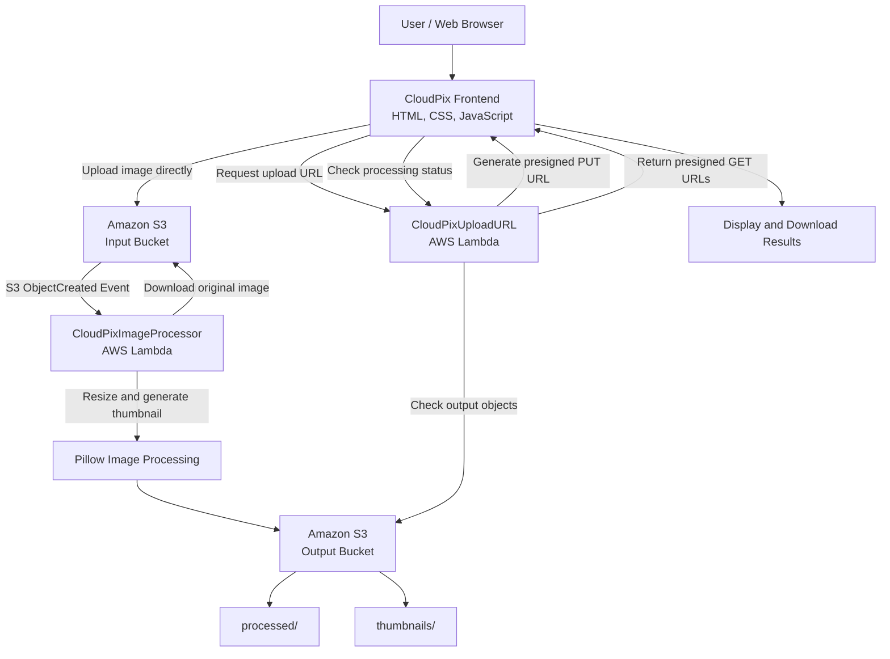

# ☁️ CloudPix
### Serverless Image Processing Platform Using AWS S3 and AWS Lambda

## 1. Project Overview

CloudPix is a serverless image processing platform developed using Amazon Web Services (AWS). It allows users to upload images through a web interface, automatically process them in the cloud, and download the resulting images.

The application uses AWS Lambda for serverless image processing and Amazon S3 for cloud storage. Python and the Pillow library are used to resize images and generate thumbnails.

CloudPix provides a simple and user-friendly way to perform basic image processing without requiring users to install image-editing software.

## 2. Problem Statement

Image resizing and thumbnail generation are common requirements in websites and digital applications. Performing these operations manually can be time-consuming, especially when handling multiple images.

Traditional image-processing applications may also require dedicated servers or locally installed software.

CloudPix addresses this problem by providing a serverless cloud-based solution that automatically processes uploaded images using AWS services.

## 3. Project Objectives

The main objectives of CloudPix are:

- To develop a simple web-based image upload interface.
- To store uploaded images in Amazon S3.
- To automate image processing using AWS Lambda.
- To resize images while maintaining their aspect ratio.
- To generate smaller thumbnail images automatically.
- To store processed images separately from original uploads.
- To allow users to preview and download processed images.
- To demonstrate the use of serverless cloud computing.

## 4. Key Features

- **Image Upload:** Users can upload JPG, PNG, and WEBP images through the website.
- **Cloud Storage:** Original images are stored in an Amazon S3 input bucket.
- **Automatic Processing:** AWS Lambda is triggered when an image is uploaded.
- **Image Resizing:** Images are resized to fit within an 800 × 800 pixel boundary while maintaining their aspect ratio.
- **Thumbnail Generation:** A smaller thumbnail is generated with a maximum dimension of 200 × 200 pixels.
- **Processed Image Storage:** Resized images and thumbnails are stored in separate folders in the output bucket.
- **Image Preview:** Users can view the processed images on the website.
- **Download Functionality:** Users can download both the resized image and thumbnail.

## 5. AWS Architecture

CloudPix follows a serverless architecture using AWS Lambda and Amazon S3.

### Architecture Diagram



### Architecture Explanation

1. The user selects an image through the CloudPix website.
2. The frontend sends the filename and image content type to the `CloudPixUploadURL` Lambda function.
3. The Lambda function generates a temporary presigned S3 upload URL.
4. The frontend uploads the image directly to the input S3 bucket.
5. An S3 upload event triggers the `CloudPixImageProcessor` Lambda function.
6. The processing Lambda downloads the uploaded image and processes it using Pillow.
7. The resized image and thumbnail are saved in the output S3 bucket.
8. The frontend periodically checks whether processing is complete.
9. The upload Lambda checks for the generated output files and returns temporary download URLs.
10. The website displays the resized image and thumbnail and provides download options.

## 6. AWS Services Used

| AWS Service | Purpose |
|---|---|
| Amazon S3 | Stores original and processed images |
| AWS Lambda | Generates upload/download URLs and processes images |
| Amazon CloudWatch | Monitors Lambda execution logs |
| AWS IAM | Provides permissions through the existing LabRole |
| Amazon S3 Event Notifications | Triggers image processing after uploads |

### Additional Technologies

| Technology | Purpose |
|---|---|
| Python | Backend programming |
| Pillow (PIL) | Image resizing and thumbnail generation |
| HTML | Website structure |
| CSS | Website styling |
| JavaScript | Frontend functionality and AWS communication |
| Boto3 | AWS SDK for Python |
| Git and GitHub | Version control and source-code hosting |
| Visual Studio Code | Development environment |

## 7. System Workflow

### Step 1: Image Selection

The user selects an image through the website. The frontend validates that the selected file is a JPG, PNG, or WEBP image and displays a preview.

### Step 2: Upload URL Generation

The frontend sends the image filename and content type to the `CloudPixUploadURL` Lambda function.

The function generates a temporary presigned URL that allows the browser to upload the image directly to Amazon S3.

### Step 3: Cloud Storage

The original image is uploaded to the input S3 bucket under the `uploads/` folder.

### Step 4: Automatic Image Processing

The S3 upload event triggers the `CloudPixImageProcessor` Lambda function.

The function:
- Retrieves the uploaded image from S3.
- Opens the image using Pillow.
- Resizes the image to fit within 800 × 800 pixels.
- Converts the image to RGB.
- Saves the resized image in JPEG format.
- Creates a thumbnail with a maximum dimension of 200 × 200 pixels.

### Step 5: Output Storage

The processed images are saved in the output S3 bucket:

- `processed/` – Contains resized images.
- `thumbnails/` – Contains generated thumbnails.

### Step 6: Results Retrieval

The frontend sends a request to `CloudPixUploadURL` to check whether the processed images are available.

The Lambda function checks for both output objects and generates temporary presigned download URLs when they exist.

### Step 7: Display and Download

The website displays the resized image and thumbnail. Users can download either image through the provided download buttons.

## 8. Project Folder Structure

```text
CloudPix/
│
├── docs/
│
├── frontend/
│   ├── index.html
│   ├── style.css
│   └── script.js
│
├── lambda/
│   └── handler.py
│
├── output/
│
├── sample_images/
│
├── src/
│   └── image_processor.py
│
├── tests/
│
├── .gitignore
├── README.md
└── requirements.txt
```

## 9. Installation and Setup

### Prerequisites

- Python 3.x
- Visual Studio Code
- Git
- An AWS Academy Cloud Developing sandbox environment
- Access to AWS Lambda and Amazon S3

### Step 1: Clone the Repository

```bash
git clone https://github.com/Himanshi1405/CloudPix.git
```

Navigate to the project directory:

```bash
cd CloudPix
```

### Step 2: Create a Virtual Environment

```bash
python -m venv .venv
```

Activate it on Windows PowerShell:

```powershell
.\.venv\Scripts\Activate.ps1
```

### Step 3: Install Dependencies

```bash
pip install -r requirements.txt
```

The image-processing implementation uses Pillow. AWS Lambda uses Boto3 to communicate with Amazon S3.

### Step 4: Configure AWS Resources

In the AWS Academy environment:

1. Create an input S3 bucket.
2. Create an output S3 bucket.
3. Create the `CloudPixImageProcessor` Lambda function.
4. Configure the Pillow dependency using a Lambda layer.
5. Attach the provided LabRole.
6. Configure the input bucket to trigger the processing Lambda on image uploads.
7. Create the `CloudPixUploadURL` Lambda function.
8. Configure its `INPUT_BUCKET` environment variable.
9. Create and configure its Lambda Function URL.
10. Configure the required CORS settings for the website and S3 uploads.

The deployed Lambda code and bucket names must match the project configuration.

### Step 5: Configure the Frontend

Set the Lambda Function URL in `frontend/script.js` as the API endpoint.

Configure the allowed origins in the Lambda Function URL and S3 bucket CORS settings to match the website's hosting address.

### Step 6: Run the Website

Open the project in Visual Studio Code and start the frontend using the Live Server extension.

The website can be accessed through the local development address provided by Live Server.

## 10. Image Processing Details

CloudPix uses the Pillow library for image manipulation.

| Operation | Configuration |
|---|---|
| Maximum resized dimensions | 800 × 800 pixels |
| Maximum thumbnail dimensions | 200 × 200 pixels |
| Output format | JPEG |
| Colour mode | RGB |
| Processing method | AWS Lambda |
| Image library | Pillow |

The `thumbnail()` method maintains the image's aspect ratio while fitting it within the specified dimensions.

The output filenames follow these patterns:

- Resized image: `<original_name>_resized.jpg`
- Thumbnail: `<original_name>_thumbnail.jpg`

## 11. Security and Storage

CloudPix uses Amazon S3 presigned URLs to provide temporary access to image uploads and downloads.

- Original and processed images remain in private S3 buckets.
- The frontend does not contain AWS access keys or secret credentials.
- Upload and download URLs are temporary and expire after five minutes.
- The upload Lambda validates supported image content types.

**Deployment note:** The current demonstration uses a publicly callable Lambda Function URL with authentication type `NONE`. The upload endpoint should be secured with appropriate authentication and additional validation before production use.

## 12. Screenshots

The following screenshots demonstrate the working application and AWS resources.

| Screenshot | Description |
|---|---|
| CloudPix Homepage | Main website interface |
| Image Upload | Selecting an image for processing |
| Processed Image | Display of the resized image |
| Thumbnail | Generated thumbnail preview |
| Download Buttons | Downloading processed images |
| AWS Lambda | Deployed Lambda functions |
| Input S3 Bucket | Uploaded original images |
| Output S3 Bucket | Resized images and thumbnails |
| CloudWatch Logs | Lambda execution evidence |

*Project screenshots can be added to the repository's `docs/` folder and linked here.*

## 13. Limitations

- The current implementation is designed for common image formats: JPG, PNG, and WEBP.
- The application currently uses a simple browser-based interface.
- The AWS Academy sandbox is a temporary learning environment and is not intended for permanent production hosting.
- The publicly callable Lambda Function URL requires additional security measures before production deployment.
- The application currently focuses on basic resizing and thumbnail generation rather than advanced image editing.

## 14. Future Enhancements

Possible future improvements include:

- User authentication and access control.
- Image compression and optimisation.
- Support for additional image formats.
- Batch image processing.
- Image metadata extraction.
- Processing history and user dashboards.
- Improved error handling and upload progress indicators.
- Production deployment with stronger API security.
- Hosting the frontend through Amazon S3 and Amazon CloudFront.

## 15. Conclusion

CloudPix demonstrates how serverless cloud computing can simplify image-processing tasks.

By combining Amazon S3, AWS Lambda, Python, and Pillow, the project provides an automated workflow for image uploading, resizing, thumbnail generation, storage, previewing, and downloading.

The project demonstrates practical applications of cloud storage, event-driven computing, serverless architecture, and frontend-backend integration using AWS.

---

## 16. Repository

**GitHub:** https://github.com/Himanshi1405/CloudPix

**Project:** CloudPix – Serverless Image Processing Platform Using AWS S3 and Lambda

**Development Environment:** AWS Academy Cloud Developing Sandbox

**AWS Region:** us-east-1

